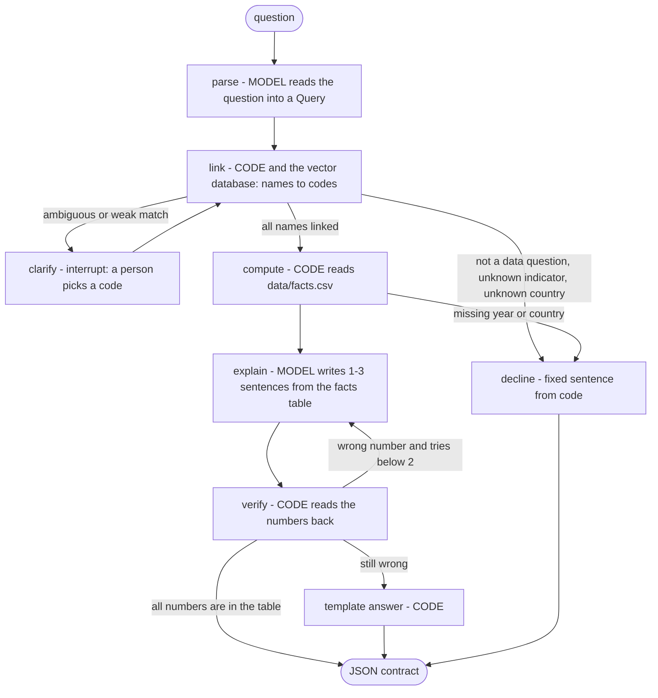

# FactDesk - every number from the table, never from the model

Capstone project 03 of the course "AI Machine Learning", chapter 2 (GenAI and AI agents). You use everything from
Lessons 2.5-2.10: LangChain, LangGraph, LangSmith and Langflow, on a NEW problem with REAL public data. Expected
effort: 10-14 hours. Package `factdesk`, conda environment `cap-facts`, collection `factdesk-entities`.

## 1. The problem

A newsroom researcher on deadline needs checkable numbers: "What was Vietnam's population in 2015?", "Compare the GDP
per person of Japan and South Korea in 2020", "By how much did Thailand's economy grow between 2010 and 2020?".
A plain chatbot answers from memory. It sounds sure, gives a number that is a few percent off or from another year,
and cannot be trusted to divide two numbers. Nobody can tell which of its answers are wrong without checking each one
by hand, and "checking by hand" is exactly the work the researcher wanted to skip.

The failure has a name: **a fluent wrong number**. FactDesk is built around one rule:

> **Every number comes from the CSV, through code. The model only understands the question and words the answer.
> Then code reads the numbers back out of the answer and refuses any number that is not in the table.**

The vector database does a job you have not seen yet: not "find a passage" but **"link a name to a row key"** -
"S. Korea", "Viet Nam" and "Rep. of Korea" all mean the row `KOR`/`VNM`; "economy size" means the column `gdp`.

## 2. What you will build



1. `parse` (model): the question becomes a small `Query` (operation, indicator text, country names, years).
2. `link` (code + vector database): each name becomes a country code, the indicator text an indicator id.
   Exact alias first, then a vector search on country chunks only, then the ambiguity rule.
3. `clarify` (a person): ambiguous or only-guessed names stop the graph with an `interrupt`; the answer is a code.
   You can resume in a NEW process. An outside effect (one outbox line) must not repeat when the node re-runs.
4. `compute` (code): `value`, `compare`, `growth`, `rank` on `data/facts.csv`. A missing cell ends in `no_data`
   and names the cell. Nothing is estimated.
5. `explain` (model) and `verify` (code): the model words the facts; code extracts every number of the answer and
   checks it against the facts and the result. One retry with the list of wrong numbers; then the answer is written
   by code (`reason` says `template`).
6. Two versions on the same cases: **v1** is a free tool-calling agent (the model chooses tools and arguments, no link,
   no verify); **v2** is this graph. The one difference: who controls the steps.

Every run ends in ONE JSON object (`python main.py ask "..."` prints it). A real answer of v2 with Qwen2.5-1.5B:

```json
{
  "question": "Compare the GDP per person of Japan and South Korea in 2020.",
  "operation": "compare",
  "indicator": "gdp_per_capita",
  "countries": ["JPN", "KOR"],
  "years": [2020],
  "facts": [
    {"code": "JPN", "year": 2020, "indicator": "gdp_per_capita", "value": 40040.77},
    {"code": "KOR", "year": 2020, "indicator": "gdp_per_capita", "value": 31721.3}
  ],
  "result": {"label": "ratio JPN/KOR", "value": 1.26},
  "unit": "current US$",
  "answer": "In 2020, Japan had a higher GDP per person at $40,040.77 compared to South Korea's $31,721.30, resulting in a ratio of approximately 1.26.",
  "verified": true,
  "status": "answered",
  "reason": "model answer verified"
}
```
`status` is one of `answered`, `needs_clarification`, `no_data`, `out_of_scope`. A question the table cannot answer
ends in a status and a sentence, never in a made-up number.

## 3. The data

Two public datasets from the GitHub organisation `datasets`, both built from World Bank indicators, fetched on
2026-11-16 at pinned commits (details, licences and attribution in `data/SOURCES.md`):

| Dataset | Pinned commit | Content | Licence |
|---|---|---|---|
| `datasets/population` | `d4b1a4a9a17e2123baf0ef119de05bceced1ab1b` | total population, 1960-2025 | ODC-PDDL-1.0 (maintainers); numbers from the World Bank (SP.POP.TOTL) |
| `datasets/gdp` | `36d761dc5617982d3e50b213e02b9a1b47c4e958` | GDP in current US dollars, 1960-2023 | CC-BY-4.0; attribution: World Bank - World Development Indicators (NY.GDP.MKTP.CD) |

`scripts/prepare_data.py` turns the raw CSV files in `data/raw/` into `data/facts.csv` (years from 1990), `data/countries.json`
(216 countries and territories plus `WLD`, the World) and the knowledge base documents in `data/docs/`. The ~48 World Bank
aggregates (regions, income groups, "IDA total" ...) are removed with a hand-checked list in `configs/app.toml`. Traps in
the data: GDP stops in 2023 while population runs to 2025; North Korea, Gibraltar and the British Virgin Islands
have no GDP at all; `XKX` (Kosovo) is a World Bank code, not an ISO code; "Korea" and "Congo" belong to two countries.
GDP is in **current** dollars, not inflation-adjusted, not PPP. A third dataset (`country-codes`) is deliberately not used:
its licence is mixed and partly restricted.

Re-fetch and re-prepare (no account, standard library only):
```bash
python scripts/fetch_data.py          # downloads data/raw/ again from the pinned commits
python scripts/prepare_data.py        # raw -> facts.csv, countries.json, data/docs/
```

## 4. The four tools in this project

| Tool | What it does HERE | Files | Stops |
|---|---|---|---|
| **LangChain** | structured output (`Query`), a chain, a retriever with a metadata filter, `@tool` functions, `create_agent` (v1) | `llm/query.py`, `llm/prompts.py`, `agents/tools.py`, `agents/free_agent.py`, `knowledge/rag_slice.py` | T01, T02 |
| **LangGraph** | the graph: state, nodes, conditional edges, retry counter, `interrupt`, SQLite checkpoints, resume in a new process | `graph/`, `knowledge/linker.py`, `runtime/desk.py` | T03, T04, T05 |
| **LangSmith** | traces with tags and metadata, evaluators that run locally and on the cloud, experiments v1 vs v2, `compare` | `evaluation/`, `observability/trace_config.py`, `my_work/notes.toml` | T06, T07 |
| **Langflow** | one slice rebuilt as a flow: "what does this number mean?" over the same Chroma collection, same models, same prompt | `flows/`, `integrations/flow_compare.py` | T08 |

**What Langflow cannot do here, and why that matters.** The flow is Chat Input -> embeddings -> Chroma -> parser -> prompt
-> model -> Chat Output. It can search and word an answer. It has no tool and no code step, so it cannot compute a ratio, cannot
refuse a number that is not in the table, cannot stop to ask which Korea you mean, and cannot retry with a list of
wrong numbers. Ask it "What was the population of Vietnam in 2015?" and it can only quote a chunk or guess - `flow-compare` makes
you measure that. The lesson is not "Langflow is bad": it is that a visual flow is the right tool for the retrieval-and-wording
slice and the wrong tool for the part where correctness is guaranteed by code. Two more honest differences: the Chroma DB component
has no metadata filter, so the flow searches ALL chunks (countries, indicators, notes) and the code slice does the same;
and the flow has no `max_new_tokens` of its own except the model component's `max_tokens`.

## 5. Set up

Python 3.12 in a NEW conda environment, one per project. Everything runs on a laptop CPU: no paid API, no GPU.

```bash
conda env create -f environment.yml        # creates cap-facts (about 2 GB, 5-10 minutes)
conda activate cap-facts
pip install -e . --no-deps                  # from THIS folder: registers the package `factdesk`
python -m pytest -q                         # the fast tests run on the fake backend
python main.py index                        # embeds the 228 chunks into kb_store/ (first run downloads MiniLM)
```
The chat model is `Qwen/Qwen2.5-1.5B-Instruct` and the embedding model `sentence-transformers/paraphrase-multilingual-MiniLM-L12-v2`
(both from the Hugging Face cache; the first run downloads them, about 4 GB). A weak laptop: set `chat_model` to the 0.5B
model in `configs/app.toml` (`small_chat_model`); results will differ from the 1.5B numbers and the results file records the backend and model.

Three ways to run a command:

| Flag | What answers | Use it for |
|---|---|---|
| (none) | Qwen in this process (`backend = "local"`) | real results, `eval`, `ask` |
| `--fake` | rules, hashing vectors, no download | checking your CODE fast; `submit-check` refuses fake results |
| `backend = "server"` in `configs/app.toml` | the OpenAI-compatible model server (`python main.py serve-model`) | the Langflow part, which must use the same model |

**For the Langflow part (T08)** you need three more things, each in its own terminal:
```bash
python main.py serve-model                                      # terminal 1: the model + embeddings, http://127.0.0.1:8000/v1
chroma run --host 127.0.0.1 --path kb_store --port 8001         # terminal 2: the SAME collection over HTTP (stop `index` first)
conda create -n cap-facts-langflow python=3.12 -y               # terminal 3: Langflow lives in its OWN environment
conda activate cap-facts-langflow && pip install -r requirements-langflow.txt   # about 2 GB; keep langflow 1.12.6
cp .env.langflow.example .env.langflow && langflow run --env-file .env.langflow
```
Then in `configs/app.toml` set `[model] backend = "server"` and `[knowledge] store = "server"`, copy `.env.example` to `.env`,
create a Langflow API key (Settings -> Langflow API Keys) and put it in `.env` as `LANGFLOW_API_KEY`.
`python main.py servers` must show `[OK]` for the model server, Chroma and Langflow. Never run `index` and `chroma run` on
`kb_store/` at the same time. Never put a key in a file you submit: `python main.py scan-keys` checks.

**Langflow 1.12.6 notes (checked on a real run of the reference flow).**
- Start-up order: (1) `python main.py serve-model` (port 8000); (2) `chroma run --host 127.0.0.1 --path kb_store --port 8001`;
  (3) `python main.py index` with `store = "server"` in `configs/app.toml` (it fills the running Chroma server, not the folder);
  (4) Langflow (`langflow run --env-file .env.langflow`, port 7860).
- Component names in the UI: **Chat Input**, **OpenAI Embeddings**, **Chroma DB**, **Parser**, **Prompt Template**, **OpenAI**,
  **Chat Output**. In **Chroma DB** leave **Persist Directory EMPTY**: the flow talks to the Chroma server by host and port.
- The model dropdowns of **OpenAI** and **OpenAI Embeddings** list only OpenAI names. TYPE the local model name
  (`Qwen/Qwen2.5-1.5B-Instruct` for the chat model, `sentence-transformers/paraphrase-multilingual-MiniLM-L12-v2` for the
  embeddings), set the base URL to `http://127.0.0.1:8000/v1`, and put any placeholder such as `local` in the API key field.
- On **OpenAI Embeddings** switch **TikToken OFF**. If it is on, the model server refuses the request: it receives token ids instead of text.
- `flow-ask` and `flow-compare` need `LANGFLOW_API_KEY` in the environment of the terminal that runs `main.py` (`.env` or `export`),
  even when Langflow runs with auto-login. Create it in Langflow: Settings -> Langflow API Keys. Never commit it.
- The flow has no similarity threshold: it always passes k notes to the model, even when none fits, so it can answer a question the notes do not cover. That is a difference to report, not a bug.

## 6. The path

| Step | Command or file | What happens |
|---|---|---|
| 0 | `python -m pytest -k "not t0"` | the given infrastructure works (compute, verify, data, kit): green from the start |
| 1 | `python main.py --fake index`, `python main.py --fake ask "What was Vietnam's population in 2015?"` | see the contract once the stops are done; before that, read `graph/build.py` and `data/dev_cases.json` |
| 2 | T01 `llm/query.py` | the model reads a question into a `Query`; `pytest -k t01` |
| 3 | T02 `agents/tools.py` | two tools for the free agent; `pytest -k t02` |
| 4 | T03 `knowledge/linker.py` | link names to codes; `python main.py link "S. Korea"`; `pytest -k t03` |
| 5 | T04, T05 `graph/routes.py`, `graph/nodes/clarify.py` | the routers and the interrupt; `pytest -k "t04 or t05"` |
| 6 | `python main.py --fake ask "..."` and `pytest -k t09` | the whole graph on the fake backend: `t09` fails at an unfinished stop |
| 7 | `python main.py index` then `python main.py ask "..."` | real model, real vectors; read the trace path it prints |
| 8 | `python main.py ask "What was the population of Korea in 2015?" --thread A` then, in a NEW terminal, `python main.py resume --thread A --choice KOR` | interrupt and resume across two processes |
| 9 | T06 `evaluation/evaluators.py`; `python main.py eval v1`; `python main.py eval v2` | scores on the 12 dev cases, saved in `results/` |
| 10 | `python main.py compare v1 v2` | case by case: better AND worse |
| 11 | T07 `observability/trace_config.py`, `my_work/notes.toml` | label the runs; read traces with `python main.py trace-show runtime/traces/<file>.json` |
| 12 | `python main.py eval v2 --cloud` (optional) | the same evaluators on LangSmith; needs `LANGSMITH_API_KEY` in `.env` |
| 13 | T08: build the flow in Langflow, export it to `flows/`, `python main.py flow-show flows/<file>.json`, `python main.py flow-ask "What does GDP mean?"`, `python main.py flow-compare`, implement `compare_answers` | the Langflow slice and the comparison |
| 14 | T09 `REPORT.md` | what you saw, with numbers from your own results |
| 15 | `python -m pytest -q`, `python main.py scan-keys`, `python main.py submit-check` | everything must say `[OK]` |

Honesty rules: tune on the 12 dev cases only. The instructor runs 8 hold-out cases, once, on your final version.

## 7. Your TODO stops

Each stop is one function or one small group, 5-25 lines, in the shape `# TODO Tnn -- ...` / `# CHECK: ...` / `raise NotImplementedError`.
Hints in three levels (idea, API, near-code) are in `docs/HINTS.md`.

| Stop | File | Tool family | Check | Minutes |
|---|---|---|---|---|
| T01 | `src/factdesk/llm/query.py` | LangChain | `pytest -k t01` | 30 |
| T02 | `src/factdesk/agents/tools.py` | LangChain | `pytest -k t02` | 30 |
| T03 | `src/factdesk/knowledge/linker.py` | LangGraph + vector DB | `pytest -k t03` | 60 |
| T04 | `src/factdesk/graph/routes.py` | LangGraph | `pytest -k t04` | 30 |
| T05 | `src/factdesk/graph/nodes/clarify.py` | LangGraph | `pytest -k t05` | 60 |
| T06 | `src/factdesk/evaluation/evaluators.py` | LangSmith | `pytest -k t06` | 40 |
| T07 | `src/factdesk/observability/trace_config.py`, `my_work/notes.toml` | LangSmith | `pytest -k t07`, notes by `submit-check` | 90 (with the runs) |
| T08 | `src/factdesk/integrations/flow_compare.py`, `flows/` | Langflow | `pytest -k t08`, `flow-compare` | 150 |
| T09 | `REPORT.md` | report | `submit-check` | 90 |

Plus about 3 hours for setup, the real-model runs (each `eval` takes 8-25 minutes on a laptop CPU) and reading.
`compute/`, `verify/numbers.py` and the data are GIVEN with tests: read `verify/numbers.py` first, number extraction is subtler than it looks
("1.26 times", "97.5 million", "2,345", "12%", years).

## 8. What to hand in

A git repository (push it; do not commit `.env`, `kb_store/`, `runtime/`) with:

1. your code (the stops done), `python -m pytest -q` green and `python tools/style_lint.py --allow-consts-in prompts.py src main.py tools tests scripts` printing `violations: 0`;
2. `results/v1.json`, `results/v2.json` (and the `.csv`) from the REAL model, and `results/flow_compare.json`;
3. the exported flow in `flows/` (no key inside: `flow-show` must say `[OK] no password field holds a value`);
4. `my_work/notes.toml` filled and `REPORT.md` filled;
5. `python main.py submit-check` saying `submit-check: [OK]` (stops done, notes filled, report filled, real-backend results,
   a flow without secrets, no key in any file).

Deadline: before the next session.

## 9. Rubric (100 points)

| Line | Points | Observable criteria |
|---|---|---|
| **Function and contract** | 30 | **LangChain 10:** `Query` has the four fields and an enum; the parse chain returns a `Query` (3); `get_value` and `growth` have typed arguments and a docstring and return JSON, errors as JSON (4); the free agent v1 runs end to end and always ends in a valid contract (3). **LangGraph 20:** `link_country` follows alias, filtered search, ambiguity rule (6); the three routers incl. the retry counter (4); `clarify` interrupts with candidates and applies the choice (4); resume works in a NEW process and the outbox has one line per thread (4); `no_data` and `out_of_scope` end without a model answer (2) |
| **Evaluation and traces with LangSmith** | 25 | the four evaluators run locally (`eval v1`, `eval v2`) with real-model results saved and the backend recorded (8); `result_exact` and `answer_numbers_verified` correct, incl. null results (5); runs carry tags and metadata (version, case id) and traces are saved per case (4); `compare v1 v2` read and interpreted: better AND worse cases named (4); `notes.toml`: a real wrong tool argument of the agent and a case the verify step caught, each with a trace file (4) |
| **Langflow slice and comparison** | 15 | the flow runs in the Playground and via `flow-ask` with the same collection, models and prompt as `[rag]` (5); exported JSON read by `flow-show`, no secret (3); `compare_answers` correct and `flow-compare` saved (4); the written reason why the flow cannot answer the numeric question (no tool, no code step, no verify) (3) |
| **Report: errors found, limits, tool choice** | 15 | at least three real errors, each with case id, what was answered, what was right, the step to blame and the trace line (6); limits stated honestly (current prices, not PPP, one small model, 12 cases, tolerance of the number check) (4); "when is an agent enough?" argued with your own numbers (seconds, model calls, scores) (5) |
| **Code quality** | 15 | `pytest -q` green (4); style lint `violations: 0` (4); reproducible: fresh clone, `conda env create`, `index`, `eval` give the same shape of results (4); no key in any file, `submit-check [OK]` (3) |

## 10. Stretch goals

1. **Repair the operation by code.** The model sometimes reads "Which had more people, Indonesia or Pakistan?" as `value` instead of `compare`.
   Add a rule in `compute` or `link` that fixes an operation whose country count does not fit - and write down, in
   the report, what "code decides" costs you when the rule is wrong.
2. **A "none of these" option.** Let `clarify` accept `NONE` and end the run with `out_of_scope`; test it with "Taiwan" (not in the data; the vector search offers Guam).
3. **Direction check.** `verify` ignores the sign: "grew by 1.94%" passes for a population that shrank. Add a rule that compares
   the direction word (grew, fell, increased, decreased) with the sign of the result, and a dev case that proves it.

## 11. Troubleshooting

| Symptom | Fix |
|---|---|
| `NotImplementedError: T0x: ...` | Expected: that stop is not written yet. Write it, then `pytest -k t0x`. |
| `ModuleNotFoundError: factdesk` | `pip install -e . --no-deps` from this folder, inside `cap-facts`. |
| `the entity collection is empty: run python main.py index first` | Run `python main.py index` (or `python main.py --fake index` for the fake backend: it has its own collection). |
| `collection ... was built with ..., not ...` | You indexed with another embedding model: delete `kb_store/` and index again. |
| `Cannot do this: ValueError: thread 't1' has nothing to resume` | The thread already finished, was never asked, or `runtime/checkpoints.sqlite` was deleted. Ask again. |
| Each case takes 30-60 seconds | Normal on CPU. Close other programs; the model answers one request at a time. `--fake` for code checks. |
| `[NO] Chroma` in `servers` | Start `chroma run --host 127.0.0.1 --path kb_store --port 8001` and set `store = "server"`. Do not run `index` at the same time. |
| `[NO] Langflow` | `langflow run --env-file .env.langflow` in the Langflow environment; wait until the page opens. |
| Langflow refuses `127.0.0.1` for the model | `LANGFLOW_SSRF_ALLOWED_HOSTS=127.0.0.1,localhost` in `.env.langflow` (already in the example). |
| Langflow's Chroma DB component refuses to build | `LANGFLOW_RESTRICT_LOCAL_FILE_ACCESS=false` in `.env.langflow` (already in the example); keep Langflow 1.12.6. |
| `flow-ask` says 401 / needs a key | Put `LANGFLOW_API_KEY=...` in `.env`. |
| Flow run fails at OpenAI Embeddings, or the model server logs a bad `input` (numbers instead of text) | Switch **TikToken OFF** on the **OpenAI Embeddings** component; type the embedding model name yourself (the dropdown lists only OpenAI names); leave **Persist Directory** of **Chroma DB** empty. |
| `pytest -k t09` fails with `T01...` or `T07...` | It runs the whole path: it fails at the first unfinished stop it reaches. Finish the stops, then it passes. |
| `python main.py scan-keys` says `[NO]` | A key-like text is in a file you submit; remove it, keep keys in `.env` only. |
| `submit-check` says results come from `fake` | Run `eval` WITHOUT `--fake`. |
